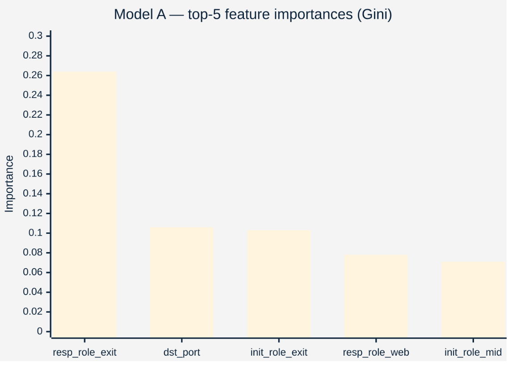

<div align="center">

# Nexora – Anomaly Detection

**A Machine Learning Subsystem for the Post-Quantum, Invitation-Gated Anonymous Peer-to-Peer Overlay Network**

*AI-driven network traffic evaluation, feature extraction, and anomaly detection benchmarked against Tor traffic.*


</div>

---

## 📌 AI Subsystem Overview

This repository contains the dedicated **Artificial Intelligence and Machine Learning layer** designed to evaluate network traffic stealth and detect protocol anomalies.

The core role of this AI component is to analyze network telemetry, classify traffic patterns, and detect anomalous peer behavior. It determines whether custom overlay traffic can be mathematically distinguished from standard encrypted Tor streams. The AI pipeline executes this through three distinct phases:

1. **Feature Engineering:** Parses raw network packet captures (`.pcap`) to extract critical behavioral flow metrics, including Inter-Arrival Time (IAT), packet length distributions, and overall flow durations.
2. **Predictive Modeling:** Evaluates the network traffic using a dual-model architecture:
   - **Random Forest:** Provides rapid, high-efficiency tabular classification of the extracted packet features.
   - **LSTM (Long Short-Term Memory):** Models sequential time-series dynamics to identify temporal anomalies and hidden patterns in the traffic flows.
3. **Stealth Benchmarking:** Scores the extracted features to evaluate the underlying protocol's ability to resist machine learning-based traffic classification, comparing its footprint directly against Tor baseline data.

---

## ✨ Key Features

- **PCAP & Traffic Parsing:** Utilizes **Scapy** and **Wireshark / TShark** pipelines to convert raw network packet captures into structured ML-ready datasets.
- **Dual ML Architecture:**
  - **Random Forest:** High-efficiency tabular classification for rapid packet feature scoring and anomaly detection.
  - **LSTM (Long Short-Term Memory):** Sequential time-series analysis to model flow dynamics and temporal traffic patterns.
- **Tor Traffic Benchmarking:** Standardized evaluation framework comparing protocol stealth and node behavior against standard encrypted Tor traffic.
- **Feature Engineering:** Extracts flow metrics including inter-arrival time (IAT), packet length distribution, payload entropy, and directional ratios.

---

## 🛠️ Tech Stack

- **Language:** Python 3.10+
- **Machine Learning & Analytics:** PyTorch / TensorFlow, Scikit-learn, XGBoost, Pandas, NumPy
- **Packet Processing:** Scapy, PyShark / Wireshark

---

## 📊 AI Pipeline & Evaluation Benchmarks

The offline evaluation pipeline (`ai/`) benchmarks two Random Forest classifiers on synthetic Tor-like traffic (`generated_datasets/tor_like_baseline/`) across three traffic regimes to assess hidden-service detectability at different telemetry granularities:

- **Model A (`ai/hidden_service_flow_classifier/`):** Per-flow binary classifier predicting whether an individual TCP flow belongs to a hidden-service session (`200 trees`, `max_depth=12`).
- **Model B (`ai/scenario_minute_profiler/`):** Per-minute aggregate profiler classifying traffic-mix regimes from coarse one-minute telemetry (`200 trees`, `max_depth=8`).

<div align="center">


*Figure 15: Synthetic dataset pack feeding per-flow (Model A) and per-minute (Model B) feature-engineering paths into Random Forest models with a 75/25 stratified train/test split.*

</div>

### Synthetic Dataset Composition (Table 5)
| Scenario | Flows (`flows.csv`) | Minutes (`minute_features.csv`) | Hidden-Service Share of Sessions |
| :--- | :---: | :---: | :--- |
| `browsing_heavy` | 2,360 | 60 | 15% |
| `hidden_service_heavy` | 4,605 | 60 | Majority |
| `mixed` | 3,156 | 60 | Intermediate |
| **Combined** | **10,121** | **180** | — |

---

### 🔍 Model A — Hidden-Service Flow Classifier

#### Held-Out Test Set Metrics (Table 6)
| Metric | Value |
| :--- | :---: |
| **Accuracy** | 0.861 |
| **Precision (`hidden_service`)** | 0.837 |
| **Recall (`hidden_service`)** | 1.000 |
| **F1 (`hidden_service`)** | 0.911 |
| **ROC-AUC** | 0.915 |

#### Confusion Matrix — 2,531 Test Flows (Table 7)
| | Predicted Non-Hidden-Service | Predicted Hidden-Service |
| :--- | :---: | :---: |
| **Actual Non-Hidden-Service** | 378 | 352 |
| **Actual Hidden-Service** | 0 | 1,801 |

#### Per-Scenario Breakdown (Table 8)
| Scenario | Test Flows | Accuracy | F1 |
| :--- | :---: | :---: | :---: |
| `browsing_heavy` | 563 | 0.710 | 0.749 |
| `hidden_service_heavy` | 1,178 | 0.936 | 0.965 |
| `mixed` | 790 | 0.856 | 0.904 |

<div align="center">


*Figure 16: Top-5 Gini feature importances for Model A (`resp_role_exit`: ~0.265, `dst_port`: ~0.105, `init_role_exit`: ~0.103, `resp_role_web`: ~0.078, `init_role_mid`: ~0.070).*

</div>

---

### ⏱️ Model B — Per-Minute Traffic-Mix Profiler

> **Key Finding:** Collapsing flows into per-minute aggregates discards endpoint-role indicators, reducing accuracy to `0.489` (vs. `0.333` baseline) and confirming that flow-level granularity is required for reliable inference.

#### Held-Out Test Set Metrics (Table 9)
| Metric | Value |
| :--- | :---: |
| **Accuracy** | 0.489 |
| **Macro F1** | 0.497 |
| **Majority-Class Baseline Accuracy** | 0.333 |

#### Confusion Matrix — 45 Test Minutes (Table 10)
| | Predicted `browsing_heavy` | Predicted `hidden_service_heavy` | Predicted `mixed` |
| :--- | :---: | :---: | :---: |
| **Actual `browsing_heavy`** | 6 | 1 | 8 |
| **Actual `hidden_service_heavy`** | 3 | 9 | 3 |
| **Actual `mixed`** | 6 | 2 | 7 |

---

## 📁 Repository Structure

```text
├── assets/                   # Architecture diagrams & evaluation charts
├── data/                     # Sample PCAPs & processed feature CSVs (git-ignored)
├── notebooks/                # Data exploration, flow analysis, & model prototyping
├── src/
│   ├── feature_extraction/   # Scapy & Wireshark PCAP parsing routines
│   ├── models/               # Random Forest & LSTM model definitions
│   └── utils/                # Data cleaning, scaling, and evaluation helpers
├── train.py                  # Model training entrypoint
├── evaluate.py               # Anomaly scoring & benchmark script
├── requirements.txt          # Python dependencies
└── README.md                 # Documentation