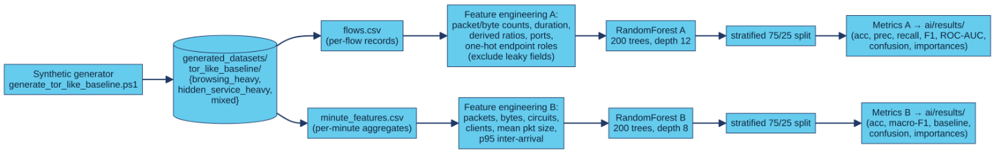

<div align="center">

# Nexora – AI Traffic-Analysis & Hidden-Service Inference

**An Offline Machine Learning Subsystem for Evaluating Traffic Stealth and Hidden-Service Detectability in Anonymous Overlay Networks**


</div>

---

## 📌 Project Overview & Honest Positioning

This repository houses the **AI Traffic-Analysis Component** (`ai/`) for the Nexora anonymous peer-to-peer overlay network[cite: 1]. Acting as an adversarial "detective" layer, it evaluates whether machine learning models can infer hidden-service activity solely by observing network traffic patterns—without decrypting payloads or accessing internal simulator phase labels[cite: 1, 3].

### What This Pipeline Is (and Is Not)
- **Offline Research Pipeline:** Built in Python using `pandas` and `scikit-learn`, this component operates offline over synthetic Tor-like datasets (`generated_datasets/tor_like_baseline/`) and outputs reproducible JSON evaluation reports to `ai/results/`[cite: 1, 2, 8].
- **Controlled Baseline Architecture:** Rather than relying on opaque black-box deep learning, it intentionally uses a well-understood, interpretable model family (**Random Forest**) with hand-engineered domain features and strict anti-leakage controls[cite: 1, 3].
- **Scope & Boundaries:** This pipeline is **not** wired into the live C++ overlay runtime as a real-time peer detector, and its metrics are measured exclusively on synthetic benchmark packs rather than live public Tor traffic or production onion services[cite: 1, 3, 8].

---

## 🧠 Core Thesis: Why Telemetry Granularity Matters More Than Model Choice

A central contribution of this subsystem is a controlled comparative experiment between **two different views of the exact same underlying network traffic**[cite: 2]:

1. **Model A (Per-Flow View):** Inspects individual TCP flow records (`flows.csv`) containing packet counts, byte volumes, durations, ports, and endpoint relay roles[cite: 2, 3]. **Result: High detection performance (`0.861` accuracy, `1.000` recall, `0.915` ROC-AUC)**[cite: 3].
2. **Model B (Per-Minute Aggregate View):** Inspects coarse one-minute network-wide summaries (`minute_features.csv`) containing total volume, active circuit/client counts, mean packet size, and p95 inter-arrival times[cite: 2, 6]. **Result: Poor classification performance (`0.489` accuracy vs. `0.333` random baseline)**[cite: 6].

> **Engineering Takeaway:** Aggregating traffic into one-minute summaries destroys the fine-grained endpoint-role and per-conversation signals that distinguish hidden-service circuits from standard browsing[cite: 1, 2, 7]. Even with the same Random Forest algorithm, a network-wide monitor limited to minute-level telemetry cannot recover what flow-level capture reveals[cite: 2].

---

## 🏗️ System Architecture & Dataset Composition

<div align="center">


*Figure 15: End-to-end AI pipeline. The synthetic generator (`generate_tor_like_baseline.ps1`) feeds two independent feature-engineering branches (per-flow and per-minute) into stratified 75/25 Random Forest classifiers, writing JSON artifacts to `ai/results/`[cite: 2].*

</div>

Both models train and evaluate on a three-regime synthetic dataset pack designed to test generalization across varying background loads[cite: 2, 4]:

| Scenario | Flows (`flows.csv`) | Minutes (`minute_features.csv`) | Hidden-Service Share of Sessions | Traffic Profile Description |
| :--- | :---: | :---: | :---: | :--- |
| `browsing_heavy` | 2,360 | 60 | 15% | Dominated by standard exit-to-web-server browsing; hardest regime for false positives[cite: 2, 4, 5]. |
| `hidden_service_heavy` | 4,605 | 60 | Majority | High concentration of introduction and rendezvous circuits[cite: 2, 3, 5]. |
| `mixed` | 3,156 | 60 | Intermediate | Balanced blend of standard browsing, maintenance, and hidden-service traffic[cite: 3, 7]. |
| **Combined Total** | **10,121** | **180** | — | Pooled across all scenarios and split 75% train / 25% test (stratified)[cite: 3, 6]. |

---

## 🔍 Model A: Hidden-Service Flow Classifier (`ai/hidden_service_flow_classifier/`)

### Objective & Anti-Leakage Feature Engineering
Given a single TCP flow's observable traffic shape, Model A predicts a binary label: whether the flow belongs to a hidden-service session (`session_type == "hidden_service"`) or standard browsing/maintenance traffic[cite: 2, 3].

To ensure realistic inference without trivial data leakage, the pipeline **explicitly strips** internal simulator `phase` labels, route/circuit/client/service IDs, and IP addresses[cite: 3]. It trains strictly on features a passive traffic observer could measure or infer[cite: 3]:
- **Volumetric & Timing Features:** `packet_count`, `byte_count`, `duration_ms`[cite: 3]
- **Derived Ratios:** `bytes_per_packet`, `duration_per_packet`[cite: 3]
- **Network Ports:** `src_port`, `dst_port`[cite: 3]
- **One-Hot Endpoint Roles (`initiator_role` & `responder_role`):** `client`, `guard`, `middle`, `exit`, `directory`, `hidden_service`, `web_server`[cite: 3]

### Hyperparameters & Dataset Split
- **Algorithm:** `RandomForestClassifier` (`n_estimators=200`, `max_depth=12`, `min_samples_leaf=2`)[cite: 3]
- **Data Split:** 10,121 pooled flows $\rightarrow$ **7,590 train** / **2,531 test** (75/25 stratified split; 7,200 hidden-service vs. 2,921 non-hidden-service flows overall)[cite: 3]

### Held-Out Test Set Performance

| Metric | Score | Operational Meaning |
| :--- | :---: | :--- |
| **Accuracy** | **0.861** | Overall correct classification rate across all 2,531 test flows[cite: 3, 4]. |
| **Precision (`hidden_service`)** | **0.837** | ~5 true positives for every 1 false positive flagged[cite: 3, 5]. |
| **Recall (`hidden_service`)** | **1.000** | Zero missed hidden-service flows on the held-out test set[cite: 3, 4]. |
| **F1 Score (`hidden_service`)** | **0.911** | Harmonic mean reflecting strong triage suitability[cite: 3, 5]. |
| **ROC-AUC** | **0.915** | High separability across classification thresholds[cite: 3]. |

#### Confusion Matrix (2,531 Test Flows)
| | Predicted Non-Hidden-Service | Predicted Hidden-Service |
| :--- | :---: | :---: |
| **Actual Non-Hidden-Service** | **378** (True Negatives) | **352** (False Positives) |
| **Actual Hidden-Service** | **0** (False Negatives) | **1,801** (True Positives) |

#### Per-Scenario Generalization Breakdown
| Scenario | Test Flows | Accuracy | F1 Score | Behavioral Note |
| :--- | :---: | :---: | :---: | :--- |
| `browsing_heavy` | 563 | 0.710 | 0.749 | Lowest accuracy due to 15% minority class overlap with dense browsing flows[cite: 4]. |
| `hidden_service_heavy` | 1,178 | 0.936 | 0.965 | Highest separation when rendezvous/introduction patterns dominate[cite: 4, 5]. |
| `mixed` | 790 | 0.856 | 0.904 | Strong generalization under mixed workload conditions[cite: 4]. |

### Feature Importance Analysis

<div align="center">


*Figure 16: Top-5 Gini feature importances for Model A (`resp_role_exit`: ~0.265, `dst_port`: ~0.105, `init_role_exit`: ~0.103, `resp_role_web`: ~0.078, `init_role_mid`: ~0.070)[cite: 5].*

</div>

Endpoint-role indicators (`responder_role_exit`, `initiator_role_exit`, `responder_role_web_server`, `initiator_role_middle`) combined with `dst_port` dominate decision splits[cite: 5]. Standard browsing terminates along exit-to-web-server paths, whereas hidden-service sessions traverse introduction and rendezvous circuits terminating at hidden-service endpoints—a structural signature clearly visible at the flow level[cite: 5].

---

## ⏱️ Model B: Per-Minute Traffic-Mix Profiler (`ai/scenario_minute_profiler/`)

### Objective & Feature Engineering
Model B tests whether a coarse network-wide monitor—logging only one-minute aggregate telemetry rather than individual flows—can classify which traffic regime (`browsing_heavy`, `hidden_service_heavy`, or `mixed`) a given minute belongs to[cite: 6]. Ground-truth session-type counters are excluded, leaving 6 observable features[cite: 6]:
- `packets` & `bytes` (per-minute totals)[cite: 6]
- `active_circuits` & `active_clients`[cite: 6]
- `mean_packet_size` & `p95_inter_arrival_ms`[cite: 6]

### Hyperparameters & Held-Out Performance
- **Algorithm:** `RandomForestClassifier` (`n_estimators=200`, `max_depth=8`, `min_samples_leaf=2`)[cite: 6]
- **Data Split:** 180 balanced one-minute records (60 per scenario) $\rightarrow$ **135 train** / **45 test** (15 per class)[cite: 6]

| Metric | Score | Notes |
| :--- | :---: | :--- |
| **Accuracy** | **0.489** | Outperforms random guessing (`0.333`) but insufficient for reliable inference[cite: 6]. |
| **Macro F1** | **0.497** | Heavy confusion between `browsing_heavy` (`F1: 0.400`) and `mixed` (`F1: 0.424`)[cite: 6, 7]. |
| **Majority-Class Baseline** | **0.333** | Balanced 3-class baseline[cite: 6]. |

#### Confusion Matrix (45 Test Minutes)
| | Predicted `browsing_heavy` | Predicted `hidden_service_heavy` | Predicted `mixed` |
| :--- | :---: | :---: | :---: |
| **Actual `browsing_heavy`** | **6** | 1 | 8 |
| **Actual `hidden_service_heavy`** | 3 | **9** | 3 |
| **Actual `mixed`** | 6 | 2 | **7** |

### Why Model B Underperforms (Documented Negative Result)
1. **Loss of Endpoint-Role Signal:** Collapsing all flows in a 60-second window into 6 scalar totals erases the relay-role routing structure that drives Model A.
2. **Sample Scarcity at Minute Granularity:** 180 minute records provide only 15 test samples per class compared to 10,121 flow records.
3. **Class Overlap in `mixed`:** By construction, `mixed` minutes blend statistics from both extremes, resulting in the lowest precision (`0.389`)[cite: 7].

---

## 📁 Repository Structure

```text
Nexora-Anomaly-Detection/
├── assets/                                      # Architecture diagrams & evaluation charts
│   ├── figure_15_ai_pipeline.png                # End-to-end pipeline flowchart
│   └── figure_16_feature_importances.png        # Model A top-5 Gini feature importances
├── generated_datasets/
│   └── tor_like_baseline/                       # Synthetic benchmark traffic pack
│       ├── flows.csv                            # Per-flow TCP telemetry (10,121 rows)
│       └── minute_features.csv                  # Per-minute aggregate telemetry (180 rows)
├── ai/
│   ├── hidden_service_flow_classifier/
│   │   └── train_flow_classifier.py             # Model A training & evaluation script
│   ├── scenario_minute_profiler/
│   │   └── train_minute_profiler.py             # Model B training & evaluation script
│   └── results/                                 # Output JSONs (metrics, matrices, importances)
├── requirements.txt                             # Python dependencies
└── README.md                                    # Project documentation